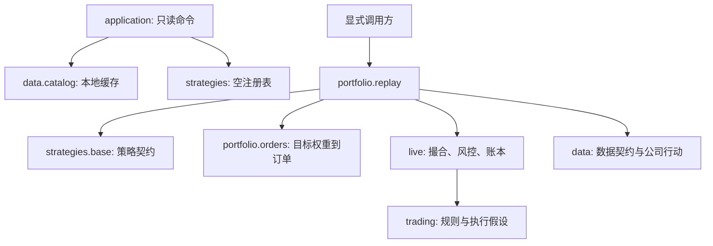

# 策略独立的量化底座

## 状态与目标

本轮先拆开数据、策略、回放、执行和展示的耦合，停止旧策略自动运行。
当前没有股票池、因子组合、TopN、ETF 配置或默认策略。研究范围与风险目标已写入 [RESEARCH_MANDATE.md](RESEARCH_MANDATE.md)，当前先核查数据能力。
既有依赖版本保留，不新增依赖；当前环境支持离线运行测试与缓存查询。

## 依赖方向

- 数据层不导入策略或执行对象。外部数据源保留显式 API，本地 CLI 不调用外部源。
- 注册表只接受显式注册，不扫描文件、不加载归档、不提供默认或回退策略。
- 策略通过 `generate_targets(StrategyContext)` 返回目标权重；空字典是显式持币决定。
- 没有策略与策略主动返回空权重是两种状态，前者直接报错，不能生成清仓信号。
- 策略收到的价格历史止于信号日，独立于引擎原始缓存；信号使用 T-1 数据，在 T 日收盘价模拟执行。
- `ReplayEngine` 在内存中运行账本与可选风控，不读写真实账本或全局风控状态。
- 回放必须显式提供公司行动表。确无事件时也要提供带 `sym/ex_date/cash_ps/stk_ps` 列的空表。
- 目标权重须非负、有限且总和不超过 1；资产必须在调用方提供的行情中，不在引擎里补池、选股或下载。
- 撮合仍使用原有费用、涨跌停与申报数量规则。风控配置由调用方显式传入；通用默认参数不是一套正在运行的策略。

## 保留和归档的能力

保留数据源、PIT、缓存、指标、交易规则、PaperBroker、Ledger、RiskGate、Reconciler、QMT 适配器和通用统计工具。
旧的多个回测入口、具体策略、选股规则、实验脚本、策略仪表盘、市场择时/轮动模块及其测试归档。
当前入口没有运行具体策略或真实委托的通路；`live.make_broker('qmt')` 明确拒绝。
QMT 适配器作为待验收的库代码保留，不因归档清除历史订单或账户状态。

## 命令和状态

`main.py status`、`strategies`、`data summary/list/show`、`archive --verify` 是当前应用命令。
`main.py run --strategy NAME` 只校验显式选择，当前无注册策略会明确失败，不启动自动交易。
需要测试策略时，代码调用 `ReplayEngine.run` 并显式传入策略、行情和公司行动。

旧 `run_*.py` 与 Paper 计划任务目标脚本只留下停用提示，返回退出码 2。
原计划任务可能因此显示“运行失败”，它表示入口已退役，不表示数据被清空；本轮没有更改操作系统任务定义。

## 当前不作出的承诺

无策略状态下不评价收益或策略有效性。新底座的回归测试不替代未来策略预注册、历史检验和券商环境验收。
历史研究裁决原文见归档；恢复旧源码不会自动恢复旧策略的证据有效性。

## 入口清理记录（2026-11-17）

统一为 webapp/app.py 后，以下旧入口已移除：
- 根目录 run_*.py（10个拒绝存根）：run_backtest / run_daily / run_daily_replay /
  run_etf / run_factor_eval / run_fundamental_eval / run_live /
  run_portfolio_backtest / run_portfolio_walkforward / run_scan
- scripts/run_cta_dashboard.py（被 webapp/app.py 完全替代）
- paper_day.bat / paper_watchdog.bat（计划任务已删，脚本已退役）
- webapp/__pycache__（旧缓存）

保留的入口：
- main.py（CLI：status/strategies/data/archive）
- webapp/app.py（★ 唯一 Web 入口：python webapp/app.py → localhost:5000）
- scripts/paper_day.py, scripts/paper_watchdog.py（保留为纵深防御存根）
- scripts/ 其余为研究脚本和数据准备工具
